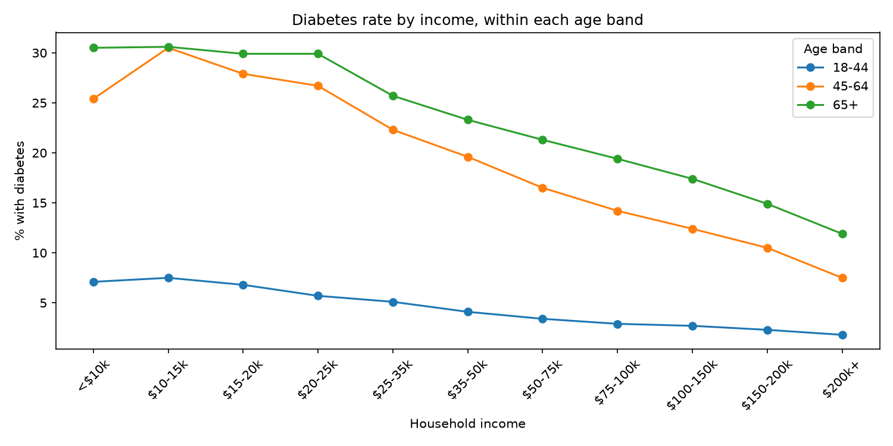

# Diabetes and Income: What the 2025 CDC Survey Shows

**Live dashboard:** https://brfss-diabetes.streamlit.app/

## The question
Is diabetes more common among people with lower incomes, and is that just because of age?

## Key finding
Diabetes rates fall steadily as income rises, and the pattern holds inside every age band. Age does not explain it away.

## Data
CDC Behavioral Risk Factor Surveillance System (BRFSS) 2025: 356,158 survey responses.

## What I did
1. **Cleaned the data in pandas.** The survey stores "Don't know" and "Refused" as numbers (7, 9, 77, 99). I turned them into missing values so they would not count as real answers. After each step, I checked that the row counts still added up to 356,158.
2. **Loaded the cleaned data into SQLite** and answered the income question in SQL. The results matched my pandas results.
3. **Checked whether age explains the pattern** by comparing income groups inside three age bands (18-44, 45-64, 65+).
4. **Looked at lifestyle factors:** BMI, exercise, and smoking.
5. **Built an interactive dashboard** in Streamlit.

## Results
- Diabetes affects about 14.6% of respondents who answered the question (51,827 of 355,376).
- By income, the rate falls from about 25% (at $10-15k) to about 6% (at $200k+).
- Inside each age band, the rate still falls as income rises (for ages 18-44: 7% to 2%; ages 45-64: 30% to 8%; ages 65+: 31% to 12%).
- BMI shows the strongest link: 7.9% for normal weight versus 22.6% for obese.
- People who did not exercise in the past 30 days had about twice the rate of those who did (23.8% vs 11.8%).
- Smoking showed a smaller link (17.4% vs 13.0%). I did not check this one by age band.

## Limitations
- **This shows association, not cause.** Low income does not necessarily cause diabetes.
- **The results are not weighted.** They describe the people surveyed, not the whole US population. BRFSS provides survey weights, which I did not use.
- **About 20% of respondents did not report income.** The income results use only the people who answered.
- **Age bands are wide.** Some age effect may remain inside them.
- **Unexplained result:** in ages 45-64, the lowest-income group (<$10k) had a lower rate (25.4%) than the next group (30.5%). I could not explain this.
- **Self-reported data.** Diabetes, exercise, and smoking are what people said, not medical records.
- **"Diabetes" here means "Yes" only.** Pre-diabetes and pregnancy-only diabetes were counted as "No."
- **Missing data:** BMI is missing for 9.1% of people, and smoking for 5.7%.
